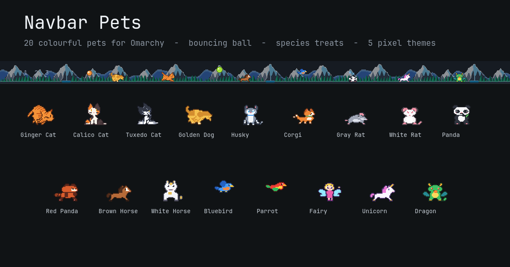

<div align="center">

# 🐾 Navbar Pets

**20 colourful pixel-art pets, 5 scenic navbar themes, bouncing ball physics, and species-matched treats for the Omarchy bar.**

[](https://omarchyplugins.com/plugin.html?id=io.github.pradeepjung45.navbar-pets)
[+-2563eb?style=flat-square)](https://omarchy.org)
[](#characters)
[](#navbar-themes)
[](LICENSE)

<br>



</div>

---

## Quick Install

Requires **Omarchy 4 (Quattro)** or newer and `python3` (already included with Omarchy). Zero extra packages, zero build step, and zero network access.

```bash
omarchy plugin add https://github.com/pradeepjung45/omarchy-navbar-pets.git --enable --yes
```

Right-click any settled pet (or the golden **Food Dot** on your bar) to pick multiple companions, drop treats, toss a bouncing ball, or switch navbar themes.

---

## Highlights

- **Multi-Pet Autonomous Ecosystem** — Select one companion or a whole pack at once. Every pet runs its own state machine, mood schedule (`wander`, `play`, `rest`), and animation timing so while one naps with `zzZ`, others stroll, gallop, or play.
- **Realistic Species Physics & Personalities** — Ground animals walk strictly on the bar floor, **only birds take flight** overhead before perching to rest/sleep, horses and unicorns gallop swiftly with hoof dust puffs, pandas waddle leisurely, fairies trail golden sparkles, and dragons puff warm embers.
- **First-Come, First-Served Species Treats** — Click the golden **Food Dot** on the bar (or **Give Food**) to drop a treat matched to your active pets (fish, bone, cheese, bamboo, apple, berry, or magic star). Pets race toward it, and the first one to arrive claims and munches it with animated crumbs and a happy `♥`.
- **Bouncing Pixel Tennis Ball (`Play`)** — Toss a physics-driven ball across the navbar with gravity, floor bounces, and wall rebounds; your pets sprint to intercept and bat it back into the air.
- **5 Pixel-Art Navbar Themes** — Transform the bar floor behind your pets with seamless, transparent-sky pixel landscapes (**Forest**, **Mountain**, **Space**, **Beach**, **Castle**) plus subtle live atmosphere (fireflies, falling snow, shooting stars, surf foam, flickering torches).
- **Reacts to Your Desktop** — Follows your cursor along the bar, dances with floating `♪ ♫` music notes during MPRIS playback, trots over to notifications, scampers on workspace or theme switches, follows a day/night rhythm, and settles through the classic `stop → wash → scratch → yawn → sleep` sequence.
- **Out of Your Way** — Strictly confined inside the bar strip, 100% click-through everywhere pets are not settled, persists all selections across restarts/reboots via `shell.updateEntryInline`, and uses its own namespaced IPC target (`io.github.pradeepjung45.navbar-pets`).

---

## Characters

Twenty characters ship across seven groups, all sharing a consistent 32-frame animation layout at both `32px` and `16px`:

| Group | Character IDs | Style & Behaviour | Favorite Treat |
|---|---|---|---|
| **Themed** | `neko`, `tora`, `dog` | Two-tone `oneko` sprites that adapt live to your Omarchy bar theme | Fish / Bone |
| **Cats** | `cat-ginger`, `cat-calico`, `cat-tuxedo` | Full-colour pixel art, agile pounces & cozy naps | Fish |
| **Dogs** | `dog-golden`, `dog-husky`, `dog-corgi` | Energetic trot (`1.08×`), loves chasing the bouncing ball | Bone |
| **Rats** | `rat-gray`, `rat-white` | Quick nimble scurries (`1.18×`) along the bar floor | Cheese |
| **Pandas** | `panda`, `panda-red` | Relaxed unhurried waddle (`0.78×`) & long naps | Bamboo |
| **Horses** | `horse-brown`, `horse-white` | Fast grounded gallop (`1.24×`) with hoof dust puffs | Apple |
| **Birds** | `bird-blue`, `bird-parrot` | Soars overhead (`1.22×`) in flight, perches on the floor to rest & eat | Berry |
| **Fairy Tales** | `fairy-pixie`, `fairy-unicorn`, `fairy-dragon` | Pixie sparkles, grounded galloping unicorn, ember-puffing dragon | Magic Star |

---

## Navbar Themes

Pick a backdrop from the right-click menu or via IPC. All themes keep the upper sky transparent and use tasteful opacity so your bar widgets and pets stay crystal clear.

| Theme | Key | Scenery & Live Effects |
|---|---|---|
| **None** | `none` | Clean transparent bar (default) |
| **Forest** | `forest` | Layered pines & oaks, mossy turf, toadstools, glowing fireflies & drifting leaves |
| **Mountain** | `mountain` | Snow-capped Alpine peaks, glacial waterfall, spruce treeline, mist & falling snow |
| **Space** | `space` | Crescent moon, spiral galaxy, ringed Saturn, Earth, twinkling stars & shooting stars |
| **Beach** | `beach` | Sunset ocean shimmer, tropical island, sailboat, palms, golden sand & surf foam |
| **Castle** | `castle` | Conical-roof stone towers, battlements, glowing windows, royal banners & flickering torches |

---

## Desktop Reactions & Priority

Reactions follow a clear priority order where waking interactions always outrank sleep:

```text
petted > food > play/ball > cursor > startled > notification > music > idle/sleep > wander
└─────────────────────────── awake ────────────────────────────┘   └──── asleep ────┘
```

| Event | What your pets do |
|---|---|
| Click a settled pet | Looks up, grooms happily, and floats a `♥` |
| Click the **Food Dot** or **Give Food** | Flash `!`, race to the species treat; first pet to arrive eats it |
| Click **Play** | Tosses a bouncing tennis ball; pets sprint and bat it back |
| Move mouse onto the navbar | Active pets walk/run along the bar to follow your pointer |
| Play music (MPRIS) | Bob on the spot with floating `♪ ♫` notes |
| Notification toast arrives | Trot to the toast end of the bar and watch until it clears |
| Switch workspace or theme | Startle and scamper down the bar |
| Leave pointer idle / solo nap | Sit → wash → scratch → yawn → curl up sleeping with animated `zzZ` |

### Crepuscular Day/Night Rhythm

Pets naturally follow a cat's daily rhythm (set `rhythm: false` to keep behaviour identical all day):

| Hours | Phase |
|---|---|
| `23:00–06:00` | Night — settles down to sleep sooner and stirs less often |
| `06:00–09:00` | Dawn — lively morning energy |
| `09:00–17:00` | Day — balanced strolling, play, and solo naps |
| `17:00–20:00` | Dusk — frisky evening energy |
| `20:00–23:00` | Evening — winding down |

---

## IPC Commands

Control Navbar Pets from scripts, keybindings, or your terminal via its namespaced IPC target (`io.github.pradeepjung45.navbar-pets`):

```bash
omarchy-shell io.github.pradeepjung45.navbar-pets openMenu
omarchy-shell io.github.pradeepjung45.navbar-pets feed
omarchy-shell io.github.pradeepjung45.navbar-pets play
omarchy-shell io.github.pradeepjung45.navbar-pets setCharacters cat-ginger,dog-golden,panda,horse-brown,bird-blue
omarchy-shell io.github.pradeepjung45.navbar-pets toggleCharacter fairy-dragon
omarchy-shell io.github.pradeepjung45.navbar-pets setBackdrop mountain
omarchy-shell io.github.pradeepjung45.navbar-pets setSize 24
omarchy-shell io.github.pradeepjung45.navbar-pets getCharacter
```

---

## Configuration

Menu choices are saved automatically to your plugin's inline entry in `~/.config/omarchy/shell.json` via Omarchy's scoped `shell.updateEntryInline` API and survive restarts and reboots:

```json
{
  "plugins": [
    {
      "id": "io.github.pradeepjung45.navbar-pets",
      "characters": ["cat-ginger", "dog-golden", "panda", "horse-brown", "bird-blue"],
      "backdrop": "mountain",
      "foodDot": true,
      "autoPlay": true,
      "size": 24,
      "speed": 1.0,
      "pettable": true,
      "chaseCursor": true,
      "pounce": true,
      "rhythm": true,
      "avoidCenter": 0.2,
      "sleepAfter": 180,
      "stirEvery": 150,
      "stirFor": 25,
      "monitor": "focused",
      "reactions": {
        "music": true,
        "charging": true,
        "workspace": true,
        "notification": true,
        "theme": true
      }
    }
  ]
}
```

| Key | Default | Meaning |
|---|---|---|
| `characters` | `["neko"]` | Array of character IDs roaming the bar together |
| `character` | `"neko"` | Fallback single character ID when `characters` is empty |
| `backdrop` | `"none"` | Navbar pixel-art theme: `none`, `forest`, `mountain`, `space`, `beach`, `castle` |
| `size` | `24` | Pet sprite height in logical pixels (`12`–`64`) |
| `speed` | `1.0` | Global movement speed multiplier (`0.25`–`3.0`) |
| `foodDot` | `true` | Show the clickable golden Food Dot on the bar |
| `autoPlay` | `true` | Let pets autonomously play and chase on their own |
| `pettable` | `true` | Allow clicking settled pets to pet them |
| `chaseCursor` | `true` | Follow the pointer while it rests on the navbar |
| `pounce` | `true` | Agile pets pounce playfully on cursor arrival |
| `rhythm` | `true` | Follow the crepuscular day/night energy cycle |
| `avoidCenter` | `0.2` | Fraction of the bar's middle kept clear of the clock (`0` disables) |
| `sleepAfter` | `180` | Seconds of pointer stillness before all pets fall asleep |
| `stirEvery` | `150` | Average seconds between brief stirs while sleeping |
| `stirFor` | `25` | Seconds a stirring pet wanders before curling back up |
| `monitor` | `"focused"` | `"focused"` to follow your active monitor, or pin an output name |
| `reactions` | all `true` | Toggle `music`, `charging`, `workspace`, `notification`, and `theme` individually |

---

## Removal

```bash
omarchy plugin remove io.github.pradeepjung45.navbar-pets
```

Or disable without deleting:

```bash
omarchy plugin disable io.github.pradeepjung45.navbar-pets
```

Removing the plugin cleans up its entry in `~/.config/omarchy/shell.json`. It creates no extra files or caches outside its plugin directory, and its read-only Hyprland cursor sampler (`bin/navbar-cat-cursor`) exits automatically with the shell via `PR_SET_PDEATHSIG`.

---

## Architecture & Development

| File | Role |
|---|---|
| `Cat.qml` | Panel overlay, multi-pet tick loop, bouncing ball physics, species particles, backdrop rendering, IPC |
| `CatSprite.qml` | Frame selection, crisp 16px/32px sheet switching, two-tone & full-RGBA rendering |
| `CatMenu.qml` | Right-click pet picker, theme switcher, treat/play controls, and toggles |
| `Brain.js` | Pure, QML-free behaviour state machine (fully unit-tested with a deterministic clock) |
| `Frames.js` | Generated catalog and pose-to-frame index map |
| `bin/navbar-cat-cursor` | Lightweight read-only Hyprland UNIX socket cursor sampler (~0.03ms/sample, zero `hyprctl` spawns) |
| `tools/animal_sprites.py` | Hand-crafted 32×32 pixel-art definitions and detail-preserving 32→16 downscaler |
| `tools/build-sprites.py` | Stdlib-only PNG spritesheet builder with automatic foot-baseline grounding |
| `tools/build-themes.py` | Seamless 480×32 transparent-sky pixel-art navbar landscape generator |
| `tools/build-preview.py` | Renders `preview.png` from the shipped spritesheets and mountain panorama |

Run the test suite and Omarchy manifest validator locally:

```bash
node --test "test/*.test.mjs"
omarchy plugin validate .
```

---

## Credits & Licence

- Code is released under the **MIT License** — see [`LICENSE`](LICENSE).
- Built on the architecture and Hyprland cursor sampler of [`tallsam/omarchy-navbar-cat`](https://github.com/tallsam/omarchy-navbar-cat) (MIT).
- The theme-tinted `neko`, `tora`, and `dog` sprites are the **public-domain** sets from `oneko 1.2.sakura.5` — see [`vendor/oneko/PROVENANCE.md`](vendor/oneko/PROVENANCE.md).
